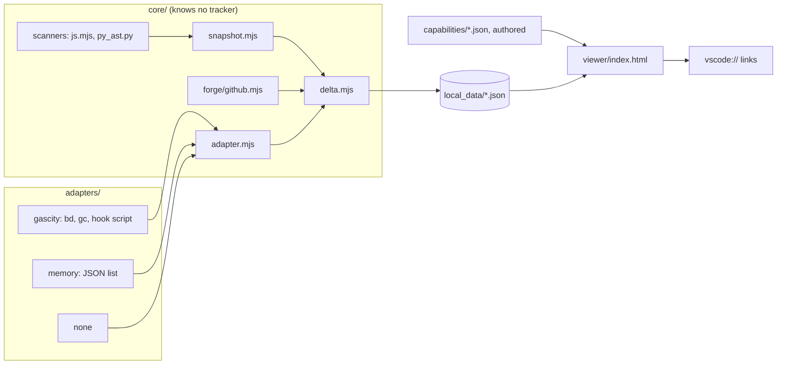

# niceswarmview

A model-level viewer for work done by agent swarms. It reads a git
repository at two points in time, builds one node per module with typed
edges, and shows what shifted as a wave: modules added, removed, renamed or
changed, facets of each change, the files and patches behind it, and the
work items that produced it, joined through an adapter. No build step, no
package dependencies, no model calls in the data path.

## Features

- Scan JavaScript, TypeScript and Python into one node per module with
  dependency and inheritance edges, fan-in and fan-out.
- Snapshot any git ref, joining coverage, complexity (CRAP) and mutation
  reports when the ref carries them, with threshold flags where a module may
  need splitting.
- Diff two snapshots into added, removed, renamed and changed modules with
  facets (members, imports, importers, rendered children, hooks, routes,
  metrics, flags), edge changes, commits, changed files with embedded
  unified patches, and a GitHub compare link.
- Join work items to a wave by work commit, by id in a commit subject, or by
  feature branch, with each item's closing note and verification.
- Browse in a static page: color by wave, metrics grade or folder; drill from
  module to members to the source line in VS Code; side-by-side or unified
  diffs; reviewed marks; an authored capabilities layer on top.

## Run

```bash
npm test                                   # scanners, adapter contract, end-to-end delta
FIX=$(examples/setup-fixture.sh)           # a two-commit example repository
node bin/snapshot.mjs --workspace demo --project "$FIX" --ref HEAD~1
NICESWARMVIEW_ADAPTER=memory NICESWARMVIEW_WORK_ITEMS=examples/work-items.json \
  node bin/delta.mjs --workspace demo --project "$FIX" --base HEAD~1 --head HEAD --id wave1
bin/serve.sh                               # http://localhost:8390/viewer/
```

Snapshots and deltas land under `local_data/<workspace>/<project>/`, which
is ignored by git. `NICESWARMVIEW_DATA` moves that folder.

## Architecture



An adapter exports `createAdapter(opts)` returning `listWorkItems(projectPath)`,
`listProjects(workspacePath)` and `workItemIdPattern`; the full shape is in
`core/adapter.mjs` and the contract test in `tests/adapter-contract.mjs`. The
Gas City adapter is the reference backend: a city holds rigs (git
repositories), work is tracked as beads, and a hook on bead close
(`adapters/gascity/on-work-item-closed.sh`) snapshots and deltas each closed
bead. Any tracker that can export a JSON list works through the memory
adapter today.

## Layers in the viewer

capabilities (authored) > project > folder > module > member > source line.

## License

Apache License 2.0, see `LICENSE` and `NOTICE`. Contributions follow
`CONTRIBUTING.md` (DCO sign-off, inbound equals outbound).

Created by Michael Jacobs.
